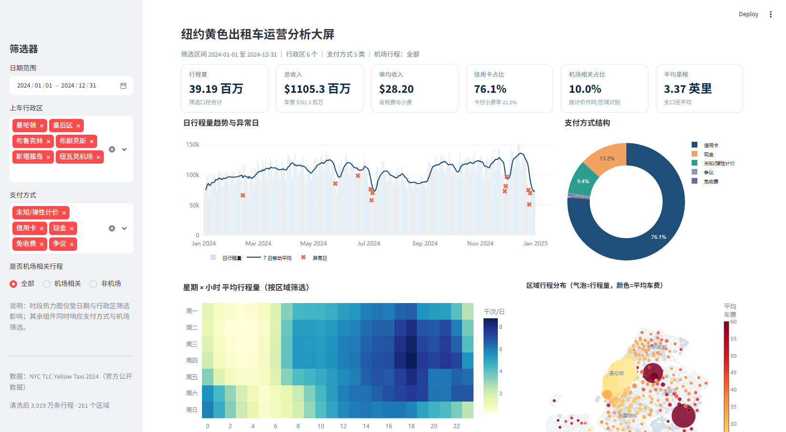

# 纽约黄色出租车运营分析与需求预测

> 《商业数据分析》期末大作业 · 数据科学与大数据技术专业
>
> 以 **NYC TLC 2024 年黄色出租车行程记录** 为主数据源，完成
> “合规取数 → 流式清洗 → 六组商业模型 → 33 张 Python 图表 → Streamlit 交互大屏 → 运营建议”的端到端分析。



---

## 1. 项目简介

本项目围绕纽约市出租车与礼宾车管理局（TLC）公开发布的 **2024 年 1—12 月**黄色出租车行程记录展开，回答四个业务问题：

1. 需求在一天、一周和一年中如何分布，哪些时段与日期需要加车？
2. 收入在空间上如何集中，机场与曼哈顿核心区分别扮演什么角色？
3. 哪些区域的功能相似，应如何分组配置运力？
4. 小费行为受什么影响，能否用于服务提示而不是差别定价？

核心结论（详见论文）：

- 原始数据 **4,116.97 万行 / 660.9 MiB**，清洗后保留 **3,919.26 万行（95.20%）**，覆盖 **261 个**有上车记录的分区，全年总收入 **11.05 亿美元**；
- 需求呈“**双高峰 + 周末后移**”：17—19 时贡献 **20.19%** 的行程，18 时单小时占 **7.12%**；周末早峰消失、晚峰后移；
- 收入高度集中：曼哈顿以 **89.39%** 的行程贡献 **75.46%** 的收入；JFK 与 LaGuardia 两个机场以 **7.7%** 的行程贡献 **20.43%** 的收入；前 22 个分区（8.4%）贡献 **69.83%** 的收入；
- 信用卡行程平均小费率 **22.25%**，**55.56%** 属于慷慨小费（≥25%）；机场行程平均小费率 **21.62%**，低于非机场的 **25.08%**，慷慨小费比例相差 **22.4 个百分点**；
- SARIMAX(1,1,2)(1,0,1,7) 在 11 月验证集 MAPE **10.44%**，12 月测试集 MAPE **20.44%**；误差集中在圣诞—新年假期，说明节假日必须作为外生冲击处理；
- K-Means 将 **179 个**年行程量不低于 2,000 次的分区分为 **4 类**（轮廓系数 **0.286**）；小费梯度提升模型 AUC **0.771**，车费是最重要特征。

---

## 2. 数据来源与合规声明

| 项目 | 内容 |
|---|---|
| 数据源名称 | NYC TLC Yellow Taxi Trip Records 2024 |
| 发布机构 | New York City Taxi and Limousine Commission（TLC） |
| 数据页 URL | https://www.nyc.gov/site/tlc/about/tlc-trip-record-data.page |
| 官方下载域 | https://d37ci6vzurychx.cloudfront.net |
| 获取方式 | **Python urllib 通过 HTTPS 直接下载官方 Parquet / CSV / ZIP**，1 MiB 分块、支持 Range 断点续传，非爬虫 |
| 获取日期 | 2026-10-30 |
| 授权 / 条款 | 纽约市政府公开发布的匿名行程数据，按 TLC 数据页说明与 NYC Open Data 使用条款使用；数据按原样提供、不作准确性担保 |
| 数据规模 | 12 个月度 Parquet，合计 **41,169,720 行、693,001,713 字节（660.9 MiB）** |
| 辅助文件 | `taxi_zone_lookup.csv`（265 行）、`taxi_zones.zip`（263 个分区面） |

**合规说明**

- 数据获取全程未使用 Scrapy、requests + 网页解析、模拟登录等抓取手段；Selenium 仅用于本地
  Streamlit 大屏截图，不参与取数；取数只访问 TLC 官方 CloudFront 文件地址，属课程允许的“官方网站文件下载”方式。
- 12 个行程文件与 2 个辅助文件的字节数、行数、字段与 SHA-256 由
  [`scripts/01_load.py`](scripts/01_load.py) 自动写入 [`outputs/tables/raw_audit.json`](outputs/tables/raw_audit.json)。
- 原始数据不随仓库分发；`run_all.py --download` 可从官方地址重建，并用同一脚本复核 SHA-256。
- 详细声明见 [`docs/数据来源与使用合规声明.docx`](docs/数据来源与使用合规声明.docx)。

### 数据表结构

| 文件 | 行数 | 角色 | 说明 |
|---|---:|---|---|
| `yellow_tripdata_2024-01…12.parquet` | 41,169,720 | 事实表 | 上下车时间、乘客数、里程、费率、分区、支付与金额 |
| `taxi_zone_lookup.csv` | 265 | 维度表 | 分区编号 → 名称、行政区、服务区 |
| `taxi_zones.zip` | 263 面 | 空间维度 | TLC 出租车分区边界（Shapefile，EPSG:2263） |

分析口径：以乘客上车时间落在 `[2024-01-01, 2025-01-01)` 为准；金额单位为美元；
小费率仅对信用卡支付且车费大于 0 的行程计算；机场相关行程 = 费率代码 2/3 或上下车分区属于 1/132/138。
原始数据无行程唯一编号，重复键只统计不删除。

---

## 3. 目录结构

```
repo/
├── data/
│   ├── raw/                     # 12 个月度 Parquet、区域表、边界 ZIP（.gitignore，脚本自动下载）
│   └── clean/                   # 120 万行分层样本与聚合中间表（.gitignore，可再生成）
├── scripts/
│   ├── config.py                # 路径、配色、中文映射、绘图主题
│   ├── 01_load.py               # 官方 HTTPS 下载 + SHA-256/行数审计
│   ├── 02_clean.py              # 按月流式清洗、派生变量、聚合表与样本导出
│   ├── 03_analysis.py           # SARIMAX / K-Means / 小费模型 / ABC / BCG / STL / OD
│   ├── 04_visuals.py            # 33 张静态图（Matplotlib / Seaborn）
│   ├── 05_dashboard.py          # Streamlit + Plotly 交互大屏
│   ├── 06_snapshot.py           # Selenium 本地大屏截图（可选）
│   ├── 07_build_paper.py        # 期末论文 DOCX 生成
│   └── 08_compliance.py         # 数据来源与使用合规声明 DOCX 生成
├── outputs/
│   ├── figures/                 # fig01–fig33（PNG，200 dpi）
│   ├── tables/                  # 聚合表、模型指标 JSON、原始数据审计
│   └── dashboard/               # 大屏整页 / 概览 / 下钻截图
├── docs/                        # 期末论文（DOCX/PDF）、数据来源与使用合规声明
├── requirements.txt
├── run_all.py                   # 一键复现入口
├── LICENSE                      # 代码 MIT；数据归 NYC TLC
└── README.md
```

---

## 4. 快速开始

```bash
# 1. 克隆仓库并进入目录
git clone <repo-url>
cd repo

# 2. 安装依赖（建议 Python 3.12+，本项目在 3.14.7 验证）
pip install -r requirements.txt

# 3. 首次运行：下载原始数据 → 清洗 → 建模 → 出图
py -X utf8 run_all.py --download

# 已有 data/raw 时可跳过下载
py -X utf8 run_all.py

# 4. 启动交互大屏（浏览器打开 http://localhost:8501）
py -m streamlit run scripts/05_dashboard.py
```

> `run_all.py --dashboard` 可在出图后直接拉起大屏。
> `run_all.py --docs` 可在出图后重建论文与合规声明 DOCX。
> 大屏截图可由 `py scripts/06_snapshot.py` 自动生成（需本地已启动 8501 端口，且安装 Edge 与 Selenium）。

### 复现约定

- 随机种子固定：清洗抽样 `SEED=42`（每月再加月份序号），K-Means 与分类模型 `random_state=42`；
- 描述统计、收入、分区排名与预测使用全量聚合表；120 万行分层样本仅用于分布图、散点图与小费模型；
- 原始数据不随仓库分发，`01_load.py` 通过官方地址重建，SHA-256 见 `raw_audit.json`；
- 大屏依赖 `outputs/tables/*.csv` 与 `data/clean/trips_sample.parquet`，需先运行 `run_all.py`。

---

## 5. 分析模型与结果

| 模型 | 关键设定 | 主要结果 |
|---|---|---|
| SARIMAX 日需求预测 | (1,1,2)(1,0,1,7)，含法定假日与感恩节周外生变量；1—11 月训练、12 月测试，11 月验证选参 | 验证 MAPE 10.44%、AIC 6,807.9；测试 MAPE 20.44%、MAE 21,064.5、R² 0.276；Ljung-Box p=0.157 |
| K-Means 区域分群 | 179 个年行程量 ≥2,000 的分区；28 维特征（24 小时份额、周末/机场份额、信用卡渗透率、对数平均车费），标准化后 k=4 | 轮廓系数 0.286；四类为通勤休闲混合型、核心商业区型、夜间活力型、早高峰通勤型 |
| 梯度提升小费分类 | 信用卡行程、慷慨小费≥25%；特征含车费、里程、时长、乘客数、小时、星期、月份、上车行政区、机场标记、费率代码与时段 | AUC 0.771（逻辑回归 0.747）；准确率 75.54%、精确率 71.91%、召回率 91.86%、F1 80.67% |
| ABC / 帕累托 | 分区收入降序，累计 70% / 90% 分层 | A 类 22 个分区贡献 69.83%，B 类 17 个贡献 19.54%，C 类 222 个仅贡献 10.64% |
| 波士顿矩阵 | 分区收入份额 × 下半年相对上半年增速，按中位数切分 | 现金牛分区贡献 96.83% 的收入；明星、问题、瘦狗分区给出差异化运营动作 |
| STL 异常识别 + OD 集中度 | 日行程量 STL 分解，残差阈值识别异常日；起讫分区对集中度 | 识别 12 个异常日（暴雪、假日等）；Top 20 OD 走廊占总行程 6.13% |

所有参数依据、公式与验证过程见论文第 5 章；结果表位于
[`outputs/tables/`](outputs/tables/)，汇总指标见 [`summary_metrics.json`](outputs/tables/summary_metrics.json)。

---

## 6. 可视化作品与图表索引

### 6.1 静态图（33 张，12 类图型）

| 编号 | 图表 | 业务主题 |
|---|---|---|
| fig01–fig03 | 柱形图、折线图、热力图 | 月度/日度需求与星期×小时节律 |
| fig04–fig08 | 堆积柱、直方图、箱线图、散点图 | 收入构成、时长/距离分布与速度关系 |
| fig09–fig11 | 环形图、直方图、折线图 | 支付结构与小费行为 |
| fig12–fig14 | 帕累托组合、ABC 分层、气泡地图 | 分区收入集中度与空间结构 |
| fig15–fig18 | PCA 投影、雷达图、时段曲线、空间分布 | K-Means 四类区域画像 |
| fig19–fig21 | OD 走廊地图、条形图、分组柱形图 | 网络结构与机场/非机场对比 |
| fig22–fig25 | 多系列折线、预测扇形图、残差图 | 工作日/周末节律与 SARIMAX 预测 |
| fig26–fig28 | ROC 曲线、特征重要性、热力图 | 小费模型评估与场景差异 |
| fig29–fig33 | 四象限矩阵、异常控制图、直方图、堆积柱 | 区域机会、异常日与行政区结构 |

全部图表位于 [`outputs/figures/`](outputs/figures/)，统一 200 dpi、`figNN_主题.png` 命名。
其中 **14 张**直接对应商业模型：SARIMAX 3 张、K-Means 4 张、小费模型 2 张、ABC/波士顿矩阵 2 张、
STL 异常 1 张、OD 走廊 2 张，满足“至少 6 张业务模型图”的要求。

### 6.2 交互式大屏（Streamlit + Plotly）

- **筛选器（4）**：日期区间、行政区多选、支付方式多选、行程类型（全部 / 机场相关 / 非机场）；
- **KPI 卡（6）**：行程量、总收入、单均收入、信用卡占比、机场相关占比、平均里程；
- **图表与下钻（8）**：日趋势与异常日、支付结构、星期×小时热力图、分区收入 Top15、区域聚类散点、
  机场/非机场对比、小费率时段曲线、OD Top10；
- **明细表与 CSV 下载（1 表 + 1 下载）**：按当前筛选口径汇总分区指标；
- **联动方式**：侧边栏筛选 + 图表点击下钻 + KPI 卡同步刷新。

截图：[总览](outputs/dashboard/dashboard_overview.png) ·
[整页](outputs/dashboard/dashboard_full.png) ·
[下钻联动](outputs/dashboard/dashboard_drill.png)

---

## 7. 输出文件

| 路径 | 内容 |
|---|---|
| `outputs/tables/*.csv` | 日/月/小时/分区/OD/支付/小费聚合表与模型结果 |
| `outputs/tables/*.json` | 原始数据审计、清洗审计、预测指标、聚类/小费模型指标 |
| `outputs/figures/fig01–fig33` | 33 张成品图（200 dpi） |
| `outputs/dashboard/*.png` | 大屏整页、概览、下钻截图 |
| `data/clean/trips_sample.parquet` | 120 万行分层样本（不进入版本库） |

数据治理结果：原始 41,169,720 行 → 年内 41,169,664 行 → 分析 39,192,643 行；
剔除时长异常 524,922、里程异常 777,918、金额为负 733,884、分区异常 425,655、跨年 56 行；
重复键 9 行；乘客数/费率/拥堵费/机场费各缺失 4,091,232 行，未做插补。

---

## 8. 分工说明

本项目为个人独立完成：数据获取与清洗、模型实现、可视化与大屏、论文与仓库整理均由本人完成。

## 9. AI 使用披露

- 工具：通用 AI 编程助手。
- 环节：查询个别库的 API 用法、排查运行报错与中文字体/图表标签重叠问题、对少量段落提出语句通顺性建议。
- 数据来源、清洗口径、模型选择与参数、结果解释与商业建议均由本人确定；所有数值均由本人运行脚本得到，
  并与 `outputs/tables` 下的结果表逐项核对。AI 输出仅作为实现细节的参考，不替代分析过程。
- 详细说明见论文第 7.3 节。

## 10. 许可

- 代码：[MIT](LICENSE)
- 数据：归 NYC TLC 所有，按 TLC 数据页说明与 NYC Open Data 使用条款使用，仅用于课程学习与非商业研究。
